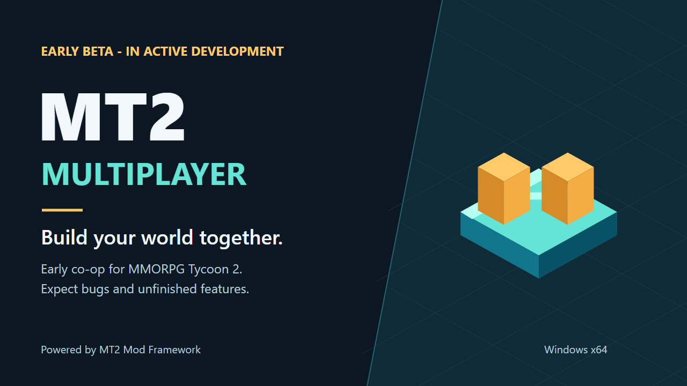
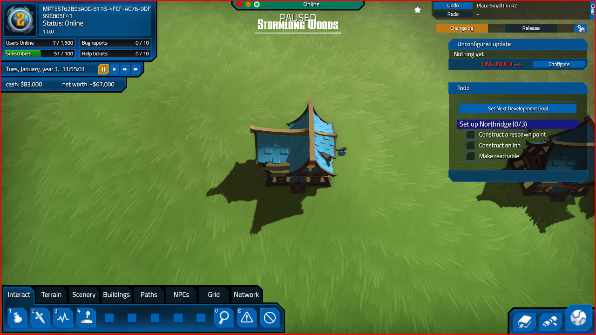

# MMORPG Tycoon 2 Multiplayer - Early Beta

> 🛟 **Need help or found a bug?** Get support at [support.doodesch.de/multiplayer](https://support.doodesch.de/multiplayer).

[Download on Nexus Mods](https://www.nexusmods.com/mmorpgtycoon2/mods/28) | [GitHub releases](https://github.com/DooDesch-Mods/MMORPGTycoon2-Multiplayer/releases) | [Changelog](https://github.com/DooDesch-Mods/MMORPGTycoon2-Multiplayer/blob/main/CHANGELOG.md)

Host a Steam lobby and invite a friend to build alongside you in MMORPG Tycoon 2. Share one world through the game's familiar tools, then save and continue together later.

**Early Beta:** Expect bugs, desyncs and unfinished features. Start with a small world and keep backups of your saves.

[Start playing](#start-playing)

The [changelog](https://github.com/DooDesch-Mods/MMORPGTycoon2-Multiplayer/blob/main/CHANGELOG.md) lists what each release adds and what was tested in game. The shared simulation routes the supported actions, but source routing does not confirm every scenario in game. Some management actions, connected travel services, modular construction and dungeons remain incomplete. Separate-account online play, large worlds and four players still need acceptance testing. [Beta 23 remains available](https://github.com/DooDesch-Mods/MMORPGTycoon2-Multiplayer/releases/tag/v0.1.0-beta.23).

## Start playing

Multiplayer requires Windows x64, the supported Steam build of MMORPG Tycoon 2, the MT2 Mod Framework Runtime version named in the release notes and the [MMORPG Tycoon 2 Vortex Extension](https://www.nexusmods.com/site/mods/2465). Both players need matching Multiplayer and dependency versions. The Framework SDK is only needed to build the mod.

1. Close the game and install the Framework Runtime and Vortex Extension.
2. Install the [Multiplayer ZIP](https://www.nexusmods.com/mmorpgtycoon2/mods/28?tab=files) in Vortex for MMORPG Tycoon 2.
3. Enable the mod, deploy and start the game through Steam.
4. Open the **Multiplayer** desktop icon, or choose **Mods... > Multiplayer > Open**.
5. Host a lobby and create or load a small world, or join your friend's lobby. Wait until both players are ready before building.

The download contains the Multiplayer plugin. Install the Framework Runtime separately. Remove an older standalone Multiplayer loader or Steam proxy before switching to this plugin.

## Report a problem in game

Open **Report a problem** in the Multiplayer window, add an optional description and choose **Send report privately**. The mod prepares the technical details for you. Keep the confirmed report number and include it when [contacting support](https://support.doodesch.de/multiplayer).

Reports stay private for 30 days. They do not include saves, chat, screenshots or Steam account IDs. Automatic technical reports are optional and off by default. Please keep passwords and personal information out of the description.

## Update or remove

Close the game, then update, disable or remove Multiplayer through Vortex. Keep your saves and profile data. Native plugins require a game restart after an update.

## For developers

See [Build from source](https://github.com/DooDesch-Mods/MMORPGTycoon2-Multiplayer/blob/main/docs/BUILDING.md) for the native plugin, packaging and test commands.

## Community

Join the DooDesch Mods Discord: update pings, polls on what comes next, and playtests of new mods.

## Credits and permissions

Created by DooDesch. The [Multiplayer license](LICENSE.md) allows source access and personal changes. Public redistribution and modified public releases require permission.

MinHook, Dear ImGui, nlohmann/json and SDL retain their own licenses; see [Third-party notices](THIRD_PARTY_NOTICES.md). [MT2 Mod Framework](https://github.com/DooDesch-Mods/MMORPGTycoon2-ModFramework) is MIT-licensed. MMORPG Tycoon 2 and its game artwork are by VectorStorm.
