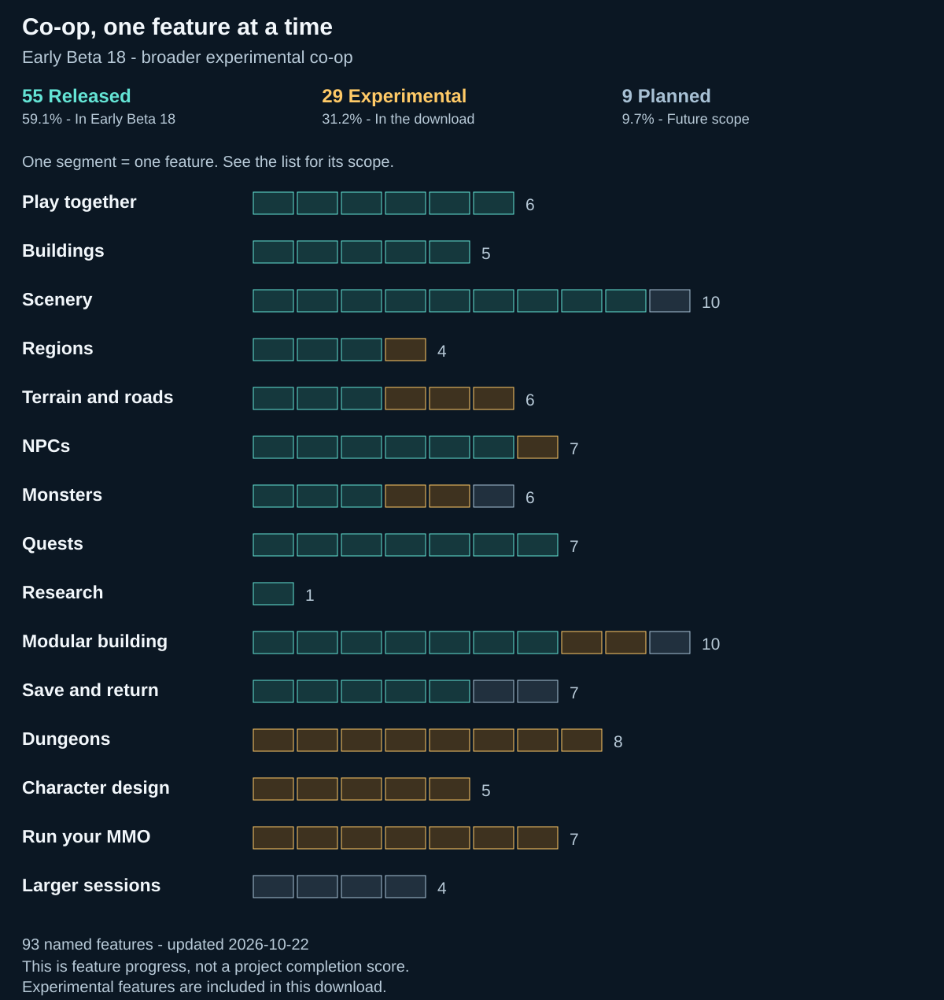
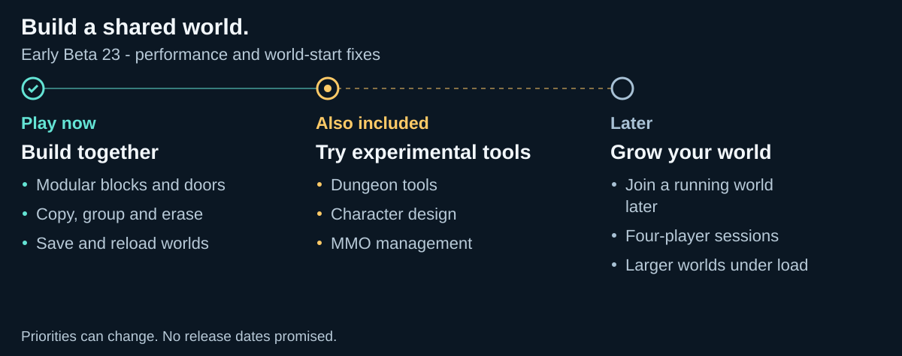

# MMORPG Tycoon 2 Multiplayer - Early Beta

> 🛟 **Need help or found a bug?** Get support at [support.doodesch.de/multiplayer](https://support.doodesch.de/multiplayer).

[Download on Nexus Mods](https://www.nexusmods.com/mmorpgtycoon2/mods/28) | [GitHub releases](https://github.com/DooDesch-Mods/MMORPGTycoon2-Multiplayer/releases) | [Changelog](https://github.com/DooDesch-Mods/MMORPGTycoon2-Multiplayer/blob/main/CHANGELOG.md)

Host a Steam lobby and invite a friend to build alongside you in MMORPG Tycoon 2. Share one world through the game's familiar tools, then save and continue together later.

**Early Beta:** Expect bugs, desyncs and unfinished features. Start with a small world and keep backups of your saves.

Shared edits can take several seconds or longer to finish. The game can occasionally crash during startup. This build adds modular building and includes experimental Dungeon, character-design and MMO-management tools. Some actions and combinations can still fail or desync.

**Early Beta 19** improves modular construction and building destinations for NPC quests. Developers can start construction on the Host while the joining player receives the current construction state. You can also leave and rejoin without closing the game, then continue placing scenery. Reconnecting after a crash or game restart remains unconfirmed.

[Feature coverage](#what-works-in-co-op) | [Roadmap](#roadmap) | [Start playing](#start-playing)

<!-- roadmap:start -->
## What works in co-op?

Play [Early Beta 19](https://github.com/DooDesch-Mods/MMORPGTycoon2-Multiplayer/releases/tag/v0.1.0-beta.19) with fixes for modular construction and NPC quest destinations. Leave and rejoin without closing the game, then continue placing scenery. Dungeon, character-design and management tools remain included as experimental; their in-game coverage is still incomplete.

<picture>
  <source media="(max-width: 600px)" srcset="https://raw.githubusercontent.com/DooDesch-Mods/MMORPGTycoon2-Multiplayer/main/docs/images/coverage-mobile.svg">
  
</picture>

| Status | Features | What it means |
| --- | ---: | --- |
| Released | 55 | Included in Early Beta 19, within the scope listed below. |
| Experimental | 29 | Included in Early Beta 19 as experimental. End-to-end game confirmation remains incomplete. |
| Planned | 9 | No completed implementation or in-game confirmation is claimed for this scope. |

Each feature has its own status. Counts describe this list, not how close the whole project is to completion.

Feature details - what is included

### Play together

| Feature | Status | Scope |
| --- | --- | --- |
| Host a Steam lobby | Released - Early Beta 19 | Open a lobby from the Multiplayer window. |
| Join a lobby | Released - Early Beta 19 | Join the Host and receive the selected world. |
| Create a shared world | Released - Early Beta 19 | The Host uses the original new-world wizard while the other player waits. |
| Send session messages | Released - Early Beta 19 | Send and read basic messages in the Multiplayer window. |
| Pause together | Released - Early Beta 19 | Pause or resume the shared world from either player. |
| Change game speed | Released - Early Beta 19 | Keep both players on the same selected simulation speed. |

### Buildings

| Feature | Status | Scope |
| --- | --- | --- |
| Place a building | Released - Early Beta 19 | Place supported buildings with shared costs. |
| Move a building | Released - Early Beta 19 | Move a supported building and preserve its shared identity. |
| Remove a building | Released - Early Beta 19 | Remove a supported building and share its refund. |
| Copy a building | Released - Early Beta 19 | Copy supported buildings, including after placement and undo/redo. |
| Undo and redo building placement | Released - Early Beta 19 | Restore the building and scenery cleared by its placement. |

### Scenery

| Feature | Status | Scope |
| --- | --- | --- |
| Place individual scenery | Released - Early Beta 19 | Place a supported scenery object with shared costs. |
| Move individual scenery | Released - Early Beta 19 | Move one scenery object with both players seeing the same pose. |
| Remove individual scenery | Released - Early Beta 19 | Remove one selected scenery object and share its refund. |
| Copy individual scenery | Released - Early Beta 19 | Create a shared copy with its own identity. |
| Group scenery | Released - Early Beta 19 | Group selected scenery objects together. |
| Copy a scenery group | Released - Early Beta 19 | Copy the group and its member objects. |
| Ungroup scenery | Released - Early Beta 19 | Ungroup either the original group or its copy. |
| Undo and redo grouping | Released - Early Beta 19 | Restore group membership and names through shared history. |
| Erase one scenery object | Released - Early Beta 19 | Use one eraser click and share the refund. Held strokes and large brushes are separate work. |
| Erase with held and large brushes | Planned | Extend the confirmed single-click eraser scope. |

### Regions

| Feature | Status | Scope |
| --- | --- | --- |
| Buy a region | Released - Early Beta 19 | Share the region purchase and cost. |
| Change a region biome | Released - Early Beta 19 | Share supported biome-style changes. |
| Change region levels | Released - Early Beta 19 | Share the selected region level range. |
| Sell a region | Experimental - Early Beta 19 | Share the ownership change and its financial effects. |

### Terrain and roads

| Feature | Status | Scope |
| --- | --- | --- |
| Paint forest terrain | Released - Early Beta 19 | Share a completed forest-terrain stamp. |
| Build a road | Released - Early Beta 19 | Place a road, including a connection to an existing endpoint. |
| Remove a road | Released - Early Beta 19 | Remove a road and share its refund. |
| Paint other terrain styles | Experimental - Early Beta 19 | Share the other active terrain-paint styles. |
| Build and remove walls | Experimental - Early Beta 19 | Share the active wall tool and its changes. |
| Draw and edit a district | Experimental - Early Beta 19 | Share district shape, height and title placement. |

### NPCs

| Feature | Status | Scope |
| --- | --- | --- |
| Place a Class Trainer | Released - Early Beta 19 | Place a Class Trainer in the shared world. |
| Move a Class Trainer | Released - Early Beta 19 | Move an existing Class Trainer. |
| Remove a Class Trainer | Released - Early Beta 19 | Remove an existing Class Trainer. |
| Place a Quest Giver | Released - Early Beta 19 | Place a Quest Giver in the shared world. |
| Move a Quest Giver | Released - Early Beta 19 | Move an existing Quest Giver. |
| Remove a Quest Giver | Released - Early Beta 19 | Remove an existing Quest Giver. |
| Edit NPC properties | Experimental - Early Beta 19 | Share the offered NPC property controls and affected quest references. |

### Monsters

| Feature | Status | Scope |
| --- | --- | --- |
| Place an Elite monster | Released - Early Beta 19 | Place an individual Elite monster while paused. |
| Move an Elite monster | Released - Early Beta 19 | Move an individual Elite monster while paused. |
| Remove an Elite monster | Released - Early Beta 19 | Remove an individual Elite monster while paused. |
| Edit a monster zone | Experimental - Early Beta 19 | Share zone shape, population settings and resets. |
| Share moving monster state | Experimental - Early Beta 19 | Publish the Host's current moving actor state. This does not claim complete combat, respawn, Boss or visitor simulation. |
| Share the full running simulation | Planned | Cover interacting combat, quests, economy and lifecycle behavior together. |

### Quests

| Feature | Status | Scope |
| --- | --- | --- |
| Create a quest | Released - Early Beta 19 | Add a quest to a supported Quest Giver. |
| Remove a quest | Released - Early Beta 19 | Remove a supported authored quest. |
| Rename a quest | Released - Early Beta 19 | Share changes to its title. |
| Change quest counts | Released - Early Beta 19 | Share changes to the required count. |
| Change quest rewards | Released - Early Beta 19 | Share XP, gold and default-reward changes. |
| Choose a building destination | Released - Early Beta 19 | Use a supported building, including a modular building, as the quest destination on both players. |
| Choose an NPC destination | Released - Early Beta 19 | Use a supported NPC as the quest destination. |

### Research

| Feature | Status | Scope |
| --- | --- | --- |
| Research Bridges | Released - Early Beta 19 | Start Bridges research, assign workers and unlock it together. |

### Modular building

| Feature | Status | Scope |
| --- | --- | --- |
| Place a modular prefab | Released - Early Beta 19 | Place a normal prefab with its selected theme. Other theme variants are not confirmed. |
| Add a modular block | Released - Early Beta 19 | Use the normal block-adding tool. |
| Remove a modular block | Released - Early Beta 19 | Use the left-click block-removal tool. |
| Add a modular entrance | Released - Early Beta 19 | Use the normal entrance-adding tool. |
| Remove a modular entrance | Released - Early Beta 19 | Use the normal entrance-removal tool. |
| Undo a modular layout edit | Released - Early Beta 19 | The Client undoes a shared layout change. |
| Redo a modular layout edit | Released - Early Beta 19 | The Host redoes that shared layout change. |
| Progress modular construction | Experimental - Early Beta 19 | Host developers can start construction, and the Client receives the current construction state. Full construction completion and all staff interactions remain experimental. |
| Remove a block with right-click | Experimental - Early Beta 19 | Use right-click in block-building mode to request a shared removal. |
| Change an existing building theme | Planned | Confirm separate theme editing and additional theme variants. |

### Save and return

| Feature | Status | Scope |
| --- | --- | --- |
| Continue a saved world | Released - Early Beta 19 | Continue together from the Host's supported saved world. |
| Save a modular world | Released - Early Beta 19 | Save the current world through the original game operation. |
| Reload a modular world | Released - Early Beta 19 | Load the saved modular world on the Host. |
| Share the loaded modular world | Released - Early Beta 19 | Load it on a Client that has already joined. This does not cover a later join. |
| Edit a loaded modular building | Released - Early Beta 19 | Continue editing after the save assigns new object identities. |
| Join an already running world later | Planned | Receive current state and continue without missing or repeating edits. |
| Rejoin after a disconnect | Planned | Leaving and rejoining without closing the game, followed by scenery placement, works in the current two-player scope. Recovery after a Client restart or connection loss remains unconfirmed. |

### Dungeons

| Feature | Status | Scope |
| --- | --- | --- |
| Place and remove a Dungeon portal | Experimental - Early Beta 19 | Keep the exterior building, Dungeon identity and related references together. |
| Open and close Dungeon cells | Experimental - Early Beta 19 | Share layout-cell edits and their history. |
| Paint Dungeon floors | Experimental - Early Beta 19 | Share the offered Dungeon paint and theme controls. |
| Place Dungeon doors | Experimental - Early Beta 19 | Share a door and its layout references. |
| Place Dungeon keys | Experimental - Early Beta 19 | Preserve the shared key-to-door relationship. |
| Place Dungeon treasure | Experimental - Early Beta 19 | Share treasure placement and references. |
| Change Dungeon lighting | Experimental - Early Beta 19 | Share authored light and palette settings. |
| Configure Dungeon instances | Experimental - Early Beta 19 | Share the offered instance configuration values. Creation, removal, entering and party lifecycles are not included in this claim. |

### Character design

| Feature | Status | Scope |
| --- | --- | --- |
| Create and copy character types | Experimental - Early Beta 19 | Share committed character-type creation, copy and variant membership commands. This does not claim every editor operation. |
| Edit a character costume | Experimental - Early Beta 19 | Share committed model, body, color and animation choices. |
| Import a character PNG card | Experimental - Early Beta 19 | Share a character-definition import through the original image-loading operation. This is not a world or map import. |
| Edit abilities | Experimental - Early Beta 19 | Share offered ability costs, effects and membership changes. |
| Edit Boss phases | Experimental - Early Beta 19 | Share offered phase and character-stat controls. |

### Run your MMO

| Feature | Status | Scope |
| --- | --- | --- |
| Place server-network nodes | Experimental - Early Beta 19 | Share the offered server-network node operations. |
| Connect server-network cables | Experimental - Early Beta 19 | Share endpoints, waypoints and connection removal. |
| Change game fees | Experimental - Early Beta 19 | Share purchase, subscription and offered service prices. |
| Take and repay loans | Experimental - Early Beta 19 | Share the loan state and resulting money changes. |
| Run advertising campaigns | Experimental - Early Beta 19 | Share campaigns, budgets and financial effects. |
| Manage developers and Game Masters | Experimental - Early Beta 19 | Share the implemented staff-assignment and job-state commands. This does not claim the whole staff simulation. |
| Publish MMO updates | Experimental - Early Beta 19 | Share the implemented release-state and committed-project commands. This does not claim every MMO-update workflow. |

### Larger sessions

| Feature | Status | Scope |
| --- | --- | --- |
| Build with four players | Planned | Confirm the same gameplay with four participants. |
| Play in larger worlds | Planned | Confirm gameplay and save behavior beyond the small-world scope. |
| Keep large sessions responsive | Planned | Confirm performance under representative multiplayer load. |
| Play across separate Steam accounts | Planned | Complete the online acceptance with separate accounts and machines. |

[See recent progress and every feature](docs/ROADMAP.md#recent-progress).

## Roadmap

<picture>
  <source media="(max-width: 600px)" srcset="https://raw.githubusercontent.com/DooDesch-Mods/MMORPGTycoon2-Multiplayer/main/docs/images/roadmap-mobile.svg">
  
</picture>

[Read the roadmap in text](docs/ROADMAP.md).
<!-- roadmap:end -->

## Start playing

You need Windows x64, the supported Steam build of MMORPG Tycoon 2, [MT2 Mod Framework Runtime 0.2.6](https://www.nexusmods.com/mmorpgtycoon2/mods/25) and [MMORPG Tycoon 2 Vortex Extension 0.1.2](https://www.nexusmods.com/site/mods/2465). Both players need matching Multiplayer and dependency versions. The Framework SDK is optional.

1. Close the game and install the Framework Runtime and Vortex Extension.
2. Install the [Multiplayer ZIP](https://www.nexusmods.com/mmorpgtycoon2/mods/28?tab=files) in Vortex for MMORPG Tycoon 2.
3. Enable the mod, deploy and start the game through Steam.
4. Open the **Multiplayer** desktop icon, or choose **Mods... > Multiplayer > Open**.
5. Host a lobby and create or load a small world, or join your friend's lobby. Wait until both players are ready before building.

The download contains the Multiplayer plugin. Install the Framework Runtime separately. Remove an older standalone Multiplayer loader or Steam proxy before switching to this plugin.

## Report a problem in game

Open **Report a problem** in the Multiplayer window, add an optional description and choose **Send report privately**. The mod prepares the technical details for you. Keep the confirmed report number and include it when [contacting support](https://support.doodesch.de/multiplayer).

Reports stay private for 30 days. They do not include saves, chat, screenshots or Steam account IDs. Automatic technical reports are optional and off by default. Please keep passwords and personal information out of the description.

## Update or remove

Close the game, then update, disable or remove Multiplayer through Vortex. Keep your saves and profile data. Native plugins require a game restart after an update.

## For developers

See [Build from source](https://github.com/DooDesch-Mods/MMORPGTycoon2-Multiplayer/blob/main/docs/BUILDING.md) for the native plugin, packaging and test commands. The [beta guide](https://github.com/DooDesch-Mods/MMORPGTycoon2-Multiplayer/blob/main/docs/BETA.md) also documents historical standalone packages.

## Credits and permissions

Created by DooDesch. The [Multiplayer license](LICENSE.md) allows source access and personal changes. Public redistribution and modified public releases require permission.

MinHook, Dear ImGui, nlohmann/json and SDL retain their own licenses; see [Third-party notices](THIRD_PARTY_NOTICES.md). [MT2 Mod Framework](https://github.com/DooDesch-Mods/MMORPGTycoon2-ModFramework) is MIT-licensed. MMORPG Tycoon 2 and its game artwork are by VectorStorm.
